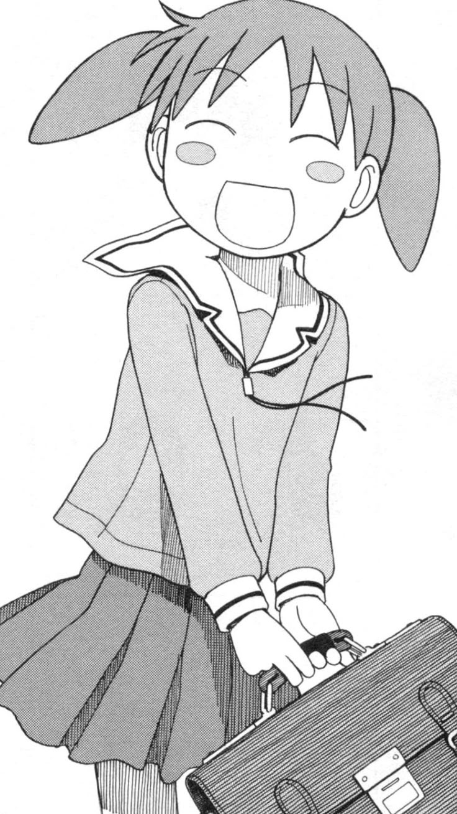

# CHIYO-CHAN VERSION 1.0

## ABOUT
* * *
Chiyo-chan is a predictive sequnence model that intakes a dataset and sorts, averages and predicts a sequence.

>Chiyo-chan has nothing to do with the intullectual property of Azumanga Daihoh please do not sue me (｡· ⩊ ·｡) 

## UPDATES 
|Version | update details| Date dd/mm/yy|
|:-------| :-------------:|--------:|
|1.0     | released into the world basic algorithims no ML involved yet| 13/11/2026|

## CREDITS
Programmer: Kiana Rodney 
Designer: Kiana Rodney 
released: 13/11/2026

### Contributors
-ADD Yourself here 